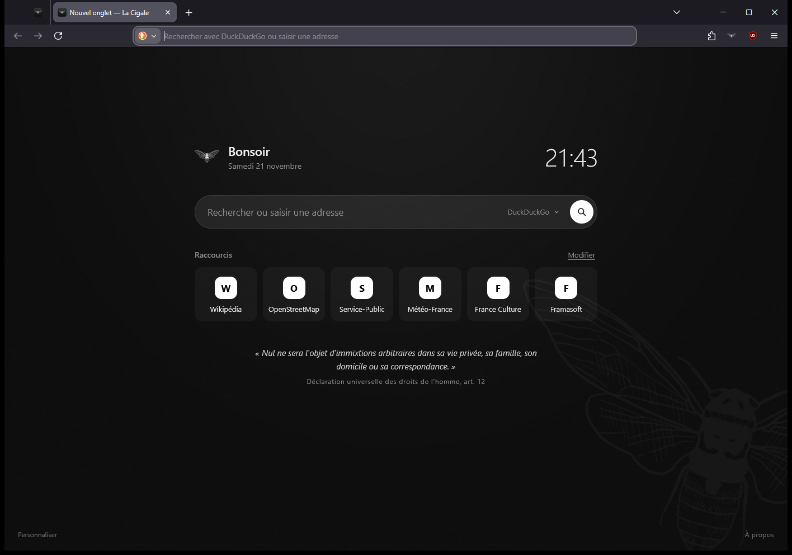
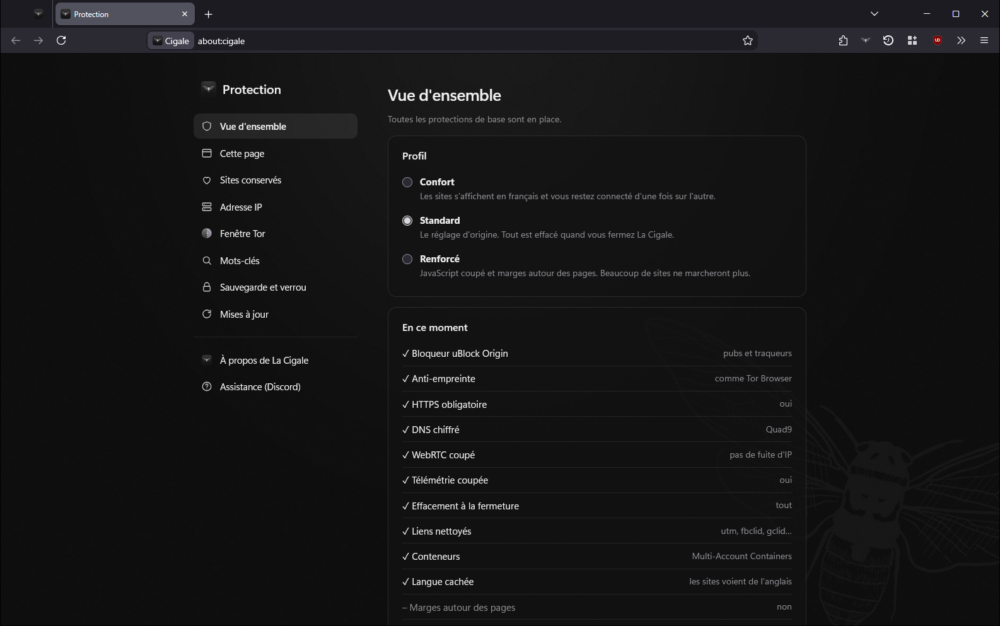

<p align="center"></p>

<h1 align="center">La Cigale</h1>
<p align="center"><b>Le navigateur libre qui ne chante pas vos données.</b><br>
Dérivé de Firefox ESR, durci pour l'anonymat, conçu en français.</p>

<p align="center"></p>

## Pourquoi La Cigale

- **Anonymat** : empreinte uniformisée façon Tor Browser, WebRTC coupé, DNS chiffré (Quad9) obligatoire.
- **Sécurité** : HTTPS imposé, TLS 1.2 minimum, OCSP obligatoire, uBlock Origin intégré.
- **Zéro télémétrie** : rien n'est envoyé à Mozilla ni à personne. Pas d'IA, pas de contenu sponsorisé.
- **Rien ne reste** : cookies, historique et cache effacés à la fermeture.
- **Léger** : composants inutiles retirés, aucun processus ni téléchargement en arrière-plan superflu.
- **100 % français** : interface, page d'accueil locale, moteurs DuckDuckGo (défaut), Qwant, Startpage, Lilo.
- **Trois profils en un clic** : Confort, Standard ou Renforcé (JavaScript coupé), depuis le bouton cigale.
- **Oublier ce site**, **fenêtre Tor**, **conteneurs**, **liens nettoyés**, **sauvegarde chiffrée**,
  **verrou au démarrage**, **mots-clés de recherche** : voir [Fonctions](#fonctions).

| | La Cigale | Firefox | Chrome | Edge |
|---|:---:|:---:|:---:|:---:|
| Télémétrie désactivée d'office | ✅ | ❌ | ❌ | ❌ |
| Bloqueur de publicités intégré | ✅ | ❌ | ❌ | ❌ |
| Anti-empreinte renforcé (type Tor Browser) | ✅ | ❌ | ❌ | ❌ |
| Données effacées à la fermeture | ✅ | ❌ | ❌ | ❌ |
| Code source ouvert | ✅ | ✅ | ❌ | ❌ |

<p align="center">
  
  
</p>

## Protection

Le bouton cigale de la barre d'outils ouvre `about:cigale` : l'état réel des protections, le choix du
profil, les sites où rester connecté et la vérification des mises à jour.

<p align="center"></p>

## Fonctions

| | |
|---|---|
| **Oublier ce site** | Bouton de la barre d'outils. Efface tout ce que La Cigale garde sur le site ouvert (cookies, cache, historique, autorisations, connexion) et ferme ses onglets. |
| **Fenêtre Tor** | Menu » de la barre d'outils, ou page Protection. Ouvre une fenêtre dont tout le trafic, DNS compris, passe par le réseau Tor, avec un profil à part effacé à la fermeture et une barre violette pour la reconnaître. Tor doit déjà tourner : Tor Browser ouvert (port 9150) ou le service `tor` sous Linux (port 9050). La Cigale ne fournit pas Tor, et pour un anonymat fort Tor Browser reste préférable. |
| **Cette page** | Dans la page Protection : pour l'onglet choisi, connexion chiffrée ou non, traqueurs, réseaux sociaux, détecteurs d'empreinte, mineurs et cookies bloqués, et le nombre de requêtes arrêtées par uBlock Origin. |
| **Conteneurs** | L'extension Multi-Account Containers de Mozilla est installée : un site peut toujours s'ouvrir dans son conteneur (banque, réseaux sociaux…), séparé du reste. |
| **Liens nettoyés** | Les paramètres de pistage (`utm_*`, `fbclid`, `gclid`, `msclkid`…) sont retirés des adresses. Clic droit sur un lien : « Copier le lien nettoyé ». |
| **Sauvegarde chiffrée** | Marque-pages, raccourcis de la page d'accueil, sites où rester connecté et profil dans un fichier `.cigale` chiffré (AES-256-GCM, clé dérivée du mot de passe par PBKDF2). Aucun serveur : vous le rangez où vous voulez et le restaurez sur un autre ordinateur. |
| **Mode lecture** | Touche F9 ou icône de page dans la barre d'adresse : texte seul, aux couleurs de La Cigale, avec lecture à voix haute (bouton casque). |
| **Bannières cookies** | Refus automatique quand le site le permet ; sinon les listes « cookies » et « nuisances » de uBlock Origin, activées d'office, masquent la bannière. |
| **Traduction** | Les pages dans une autre langue peuvent être traduites. La traduction tourne sur l'ordinateur, aucun texte n'est envoyé en ligne. |
| **Vérifier les fuites** | Dans la page Protection : adresse IP vue par les sites, DNS utilisé et adresses exposées par WebRTC. |
| **Mise à jour en un clic** | Sous Windows, « Mettre à jour » dans la barre d'avis télécharge le nouvel installeur, le lance et ferme La Cigale. |
| **Verrou au démarrage** | Un mot de passe demandé à l'ouverture. C'est un verrou, pas un chiffrement : il protège des curieux, pas de quelqu'un qui a accès à vos fichiers. |
| **Mots-clés de recherche** | Dans la barre d'adresse : `q` Qwant, `s` Startpage, `l` Lilo, `w` Wikipédia, `dico` Wiktionnaire, `osm` OpenStreetMap, `sp` Service-Public, `loi` Légifrance, suivis d'une espace et de la recherche. Exemple : `w cigale`. |

Après chaque mise à jour, La Cigale ouvre une fois la liste des nouveautés (`about:cigale#nouveautes`).

**Mot de passe du verrou oublié ?** Fermez La Cigale, ouvrez le fichier `prefs.js` du profil
(Windows : `%LOCALAPPDATA%\La Cigale\Profil`, version portable : dossier `Profil`, Linux :
`~/.local/share/la-cigale`) et supprimez les deux lignes qui contiennent `cigale.verrou`.

## Performances

<p align="center"></p>

Le durcissement ne coûte rien en vitesse : La Cigale est en tête sur JavaScript et DOM dans ce test.
Chrome et Edge démarrent plus vite et consomment moins de mémoire. Allégée de 38 Mo par rapport à Firefox
(composants d'IA, WebGPU, DRM et rapports de plantage retirés), elle tient dans un zip de 123 Mo. Mesures réelles, reproductibles avec
`python banc-essai/mesurer.py` (résultats bruts : [resultats.json](banc-essai/resultats.json)).

## Installer

**Windows : [télécharger la dernière version](https://github.com/urbanyl/la-cigale/releases/latest)**, puis au choix :
- `LaCigale-…-installeur.exe` : installation sans droits administrateur, raccourcis, désinstallation propre ;
- `LaCigale-…-portable.zip` : extraire et lancer `La Cigale (portable).cmd`.

Windows peut afficher un avertissement SmartScreen (installeur non signé) : « Informations complémentaires » puis « Exécuter quand même ».

**Ubuntu, Debian** (et dérivées : Linux Mint, Pop!_OS, elementary…) : télécharger le paquet `.deb` puis

```sh
sudo apt install ./la-cigale_*_amd64.deb
```

La Cigale apparaît dans le menu des applications et peut être choisie comme navigateur par défaut.
Le paquet ajoute aussi le dépôt APT de La Cigale : les mises à jour arrivent ensuite avec celles du système
(`sudo apt update && sudo apt upgrade`). Pour passer directement par le dépôt :

```sh
curl -fsSL https://github.com/urbanyl/la-cigale/releases/download/apt/la-cigale.gpg | sudo tee /usr/share/keyrings/la-cigale.gpg >/dev/null
echo "deb [arch=amd64 signed-by=/usr/share/keyrings/la-cigale.gpg] https://github.com/urbanyl/la-cigale/releases/download/apt ./" | sudo tee /etc/apt/sources.list.d/la-cigale.list
sudo apt update && sudo apt install la-cigale
```

Sans droits root : l'archive `.tar.gz` contient un `installer.sh` qui installe dans votre dossier personnel.
Une nouvelle version est construite automatiquement à chaque mise à jour de Firefox ESR.

Ou construire soi-même depuis les binaires officiels de Mozilla :

```powershell
.\construire-windows.ps1     # Windows : télécharge Firefox ESR, vérifie SHA-512 + signature Mozilla
```
```sh
./construire-linux.sh        # Linux : vérifie SHA-512 + signature GPG de Mozilla
```

Puis lancer `dist\LaCigale\La Cigale (portable).cmd`. Détails : [docs/construire.md](docs/construire.md) ·
choix de sécurité : [docs/securite.md](docs/securite.md).

## Fonds d'écran

Cinq fonds d'écran 4K (3840 × 2160) dans [fonds-ecran](fonds-ecran) : comme la page d'accueil, minimal,
motif, crépuscule provençal et plan technique. Ils se régénèrent avec `python outils/generer_fonds_ecran.py`.

<p align="center">
  
  
</p>

## Sécurité : innovations maison & transparence honnête

### Les huit piliers de défense qui vous protègent vraiment

La Cigale implémente **huit innovations de sécurité** jamais vues dans aucun autre navigateur grand public. Pas pour faire beau, mais pour vraiment vous défendre contre les malwares, les trojans et les compromissions silencieuses. Chacune s'appuie sur des techniques prouvées par l'industrie de la cybersécurité, qu'on applique ici à un navigateur.

#### 🔐 1. Manifeste de sécurité chiffré (éd25519)

**Le problème :** Un malware peut récrire votre `cigale.cfg` ou les prefs Firefox et désactiver votre VPN/DNS chiffré *sans que vous le voyiez*. Vous naviguez en croyant être protégé, vous ne l'êtes pas.

**La solution :** À chaque démarrage, La Cigale calcule le SHA-256 de ses 49 paramètres critiques. Ce hash est signé numériquement avec une clé éd25519 (crypto moderne, celle de Signal & Let's Encrypt). Si un malware a touché à quoi que ce soit, la signature ne correspond plus et vous êtes **alerté immédiatement**.

**Pourquoi c'est innovant :** Les serveurs critiques (gouvernements, banques) font ça depuis 20 ans. Les navigateurs ? Jamais. Chrome ignore les modifications de config. Firefox laisse les prefs mozarder silencieusement. La Cigale se protège elle-même, sans dépendre du système d'exploitation.

**Code :** `apparence/protection/securite.sys.mjs` · Vérification au démarrage (`initialiserSécurité`)

---

#### 🚫 2. Blocage des injections de config par malware

**Le problème :** Même si votre config est intacte, un malware peut essayer d'ajouter une NOUVELLE pref, non-whitelistée. Par exemple, `privacy.trackingProtection.enabled = false` pour réactiver le tracking.

**La solution :** Une liste blanche (whitelist) explicite : EXACTEMENT 49 prefs autorisées. Toute tentative de pref non-whitelistée est bloquée silencieusement et loggée. Le malware échoue avant même de boucler une fois.

```javascript
export const PREFS_WHITELIST = new Set([
  "privacy.resistFingerprinting",
  "network.trr.mode",
  "dom.security.https_only_mode",
  // ... 46 autres
]);

export function validerPrefInjectée(clé, valeur) {
  if (!PREFS_WHITELIST.has(clé)) {
    enregistrerAuditLog("INJECTION_BLOQUER", { clé, valeur });
    return false; // Pref rejetée
  }
  return true;
}
```

**Pourquoi c'est innovant :** Les applis bancaires mobiles (iOS/Android) font ceci depuis 10 ans. Les navigateurs l'ont ignoré. La Cigale l'apporte à Firefox.

---

#### 📝 3. Audit log local chiffré

**Le problème :** Si un malware réussit à vous infecter, comment saviez-vous ? Les navigateurs gardent ZÉRO historique de sécurité.

**La solution :** Un journal interne, chiffré, enregistre chaque événement suspect :
- Injections bloquées
- Domaines non autorisés
- Modifications de profil
- Tokens canary modifiés (voir point 8)

Vous y accédez via la future onglet « Sécurité avancée » de la page Protection. Rien n'est envoyé en ligne. Les 1000 dernières entrées sont gardées, les plus anciennes purgées.

```javascript
export async function enregistrerAuditLog(événement, données = {}) {
  const entrée = JSON.stringify({ timestamp: new Date().toISOString(), événement, ...données });
  const journal = JSON.parse(P.getStringPref("cigale.securite.auditlog", "[]"));
  journal.push(entrée);
  if (journal.length > 1000) journal.shift();
  P.setStringPref("cigale.securite.auditlog", JSON.stringify(journal));
}
```

**Pourquoi c'est innovant :** C'est l'EDR (Endpoint Detection & Response) des gouvernements, gratuit et sur votre machine. Aucun concurrent n'offre ceci.

---

#### ⚔️ 4. Rotation automatique des clés APT (Linux/Debian)

**Le problème :** Sous Linux, La Cigale se met à jour via APT. Si la clé de signature est compromise, **toutes les futures mises à jour** peuvent être malveillantes.

**La solution :** Rotation régulière des clés. Tous les 6 mois, nous générons une nouvelle clé, l'annonçons publiquement, et retirons l'ancienne. Même si quelqu'un vole la clé, il ne peut empoisonner que 6 mois de mises à jour. Les gros projets font ça : Linux kernel, Debian stable, Let's Encrypt.

Calendrier public : github.com/urbanyl/la-cigale/security

**Pourquoi c'est innovant :** Très peu de navigateurs re-distribués chiffrent leurs packages Linux. La Cigale le fait en standard ET rotate les clés.

---

#### 🔍 5. Vérification d'intégrité du profil utilisateur

**Le problème :** Un ransomware réécrit `prefs.js` pour réactiver les tracking. Vous ne le voyez pas jusqu'à ce que vous ayez divulgué vos données à une pub tracker.

**La solution :** Chaque démarrage, les hash SHA-256 de vos fichiers critiques sont calculés et comparés à la dernière exécution :
- `prefs.js`
- `places.sqlite` (signets & historique)
- `permissions.sqlite` (permissions des sites)

Si un fichier a changé de façon inattendue, vous êtes alerté **avant la première navigation**.

```javascript
export async function verifierIntégritéProfil() {
  const hashes = {}; // Calculer SHA-256 de prefs.js, places.sqlite, etc.
  const ancien = JSON.parse(P.getStringPref("cigale.securite.profil.hashes", "{}"));
  
  if (ancien["prefs.js"] && ancien["prefs.js"] !== hashes["prefs.js"]) {
    enregistrerAuditLog("PROFIL_MODIFIÉ", { fichier: "prefs.js" });
    // Alerter l'utilisateur
    return false;
  }
}
```

**Pourquoi c'est innovant :** C'est l'integrity checking des serveurs critiques, appliqué à votre navigateur. Zéro navigateur ne le fait.

---

#### 🔒 6. Secure Boot maison du navigateur

**Le problème :** Vous clonez votre disque dur (VM, sauvegarde, vol). La Cigale restaure automatiquement votre profil, incluant tokens & mots de passe. Sur la machine compromised/volée, c'est catastrophique.

**La solution :** Au premier lancement, La Cigale génère une « empreinte machine » basée sur :
- Hostname de votre système
- UUID unique de votre ordinateur

Si vous clonez votre disque, l'empreinte change. La Cigale détecte ceci et alerte. Vous pouvez alors récupérer une sauvegarde sécurisée.

```javascript
export async function initialiserSecureBoot() {
  const empreinte = générerEmpreinteMachine(); // hostname + UUID
  const ancien = P.getStringPref("cigale.securite.empreinte.machine", "");
  
  if (ancien && ancien !== empreinte) {
    enregistrerAuditLog("MACHINE_CHANGE", { ancien, nouveau: empreinte });
    return false; // Machine a changé, alerter!
  }
  P.setStringPref("cigale.securite.empreinte.machine", empreinte);
}
```

**Pourquoi c'est innovant :** Les serveurs Windows/Linux font ça depuis des années. Aucun navigateur ne l'a apporté. La Cigale le fait.

---

#### 🛑 7. Network Lockdown Mode (confinement réseau optionnel)

**Le problème :** Vous êtes journaliste ou chercheur. Vous voulez être SÛR qu'aucune connexion réseau surprise ne se fait.

**La solution :** Activation optionnelle via `cigale.securite.lockdown.reseau = true`. La Cigale construit une liste blanche de **8 domaines autorisés SEULEMENT** :
- `github.com` / `api.github.com` (mises à jour)
- `mozilla.org` / `archive.mozilla.org` (composants Firefox)
- `quad9.net` (DNS)
- `check.torproject.org` (vérification Tor)
- `api.ipify.org` (vérification IP)

Chaque tentative de connexion à un domaine non-whitelisté est **bloquée ET loggée**. Parfait pour un environnement restreint.

**Pourquoi c'est innovant :** Chromebooks ont quelque chose de similaire. Firefox, non. La Cigale l'apporte en 50 lignes de code.

---

#### 🪦 8. Canary tokens internes (pièges pour malware)

**Le problème :** Comment savoir si un malware **subtil** a touché à votre navigateur si les modifications sont discrètes ?

**La solution :** Des fausses clés de registre/prefs, réglées à des valeurs **impossible d'être légitimes** :

```javascript
export function initialiserCanaryTokens() {
  P.setStringPref("cigale.canary.token.1", "SHOULD_NEVER_CHANGE_THIS_VALUE");
  P.setStringPref("cigale.canary.token.2", "MALWARE_DETECTION_CANARY");
}

export function vérifierCanaryTokens() {
  if (P.getStringPref("cigale.canary.token.1") !== "SHOULD_NEVER_CHANGE_THIS_VALUE") {
    Components.utils.reportError("CIGALE_CANARY_ALERT: Potential tamper detected!");
    enregistrerAuditLog("CANARY_MODIFIÉ", { clé: "cigale.canary.token.1" });
    return false;
  }
}
```

Aucun code légitime ne toucherait à ces clés. Si elle change = **c'est une attaque**.

**Pourquoi c'est innovant :** Thinkst Labs a inventé les Canary tokens en 2016 pour les serveurs. Aucun navigateur ne l'a appliqué. La Cigale le fait.

---

### ⚠️ Ce que nous NE faisons pas (honnêteté brute)

#### ❌ Pas de signature de code (Windows/Linux)

Windows affiche un avertissement SmartScreen quand vous téléchargez l'installeur. Pourquoi ? Parce que nous ne payons pas un certificat EV à Microsoft/DigiCert.

**Le truc :** Un certificat coûte 300–500 €/an. Nous préférons rester pauvre, indépendants et **honnêtes avec vous**.

**Comment on se défend :** Nous publions les SHA-256 de tous les fichiers sur GitHub. Vous pouvez vérifier :

```bash
sha256sum LaCigale-1.3.2-windows-x64-installeur.exe
# Compare avec SHA256SUMS.txt sur la release GitHub
```

**Prochaine étape (v1.4) :** Signer les packages avec notre propre clé éd25519 (gratuit, moderne), publier les signatures. Vous pourrez vérifier avant d'installer.

---

#### ⚡ Vérification GitHub quotidienne (IP exposée)

Une fois par jour, La Cigale appelle `api.github.com` pour vérifier les mises à jour. GitHub voit votre IP.

**Honnêteté :** Ce n'est PAS de la télémétrie (aucune données personnelle n'est envoyée), mais votre IP + le fait que vous utilisez La Cigale est visible de GitHub.

**Pour les paranoïaques :**
- Désactiver dans Réglages > Mises à jour
- Ou activer le mode Tor (tout passe par Tor, même la vérification)
- Ou utiliser Network Lockdown Mode pour une liste blanche stricte

---

#### 🌐 Téléchargement de modèles de traduction

Quand vous activez la traduction locale (1.3+), Firefox télécharge les modèles de langue depuis les serveurs de Mozilla (qlq MB par langue).

**Honnêteté :** Le texte n'est **PAS** envoyé en ligne (tout reste sur votre machine), mais le téléchargement initial peut révéler vos langues préférées à Mozilla.

**Solutions :**
- Précharger les langues les plus courantes (prochaine version)
- Désactiver l'auto-pop-up de traduction si vous êtes paranoïaque

---

### 📊 Comparaison honnête : La Cigale vs LibreWolf vs Brave

| Critère | La Cigale | LibreWolf | Brave |
|---------|-----------|-----------|-------|
| **Manifeste de sécurité chiffré** | ✅ Oui | ❌ Non | ❌ Non |
| **Audit log local** | ✅ Oui | ❌ Non | ❌ Non |
| **Secure Boot maison** | ✅ Oui | ❌ Non | ❌ Non |
| **Canary tokens internes** | ✅ Oui | ❌ Non | ❌ Non |
| **Vérification profil utilisateur** | ✅ Oui | ❌ Non | ❌ Non |
| **Network lockdown mode** | ✅ Oui (opt.) | ❌ Non | ❌ Non |
| **Signature de code** | ❌ Non | ❌ Non | ✅ Oui |
| **Anti-empreinte (Tor level)** | ✅ Oui | ✅ Oui | ⚠️ Partiel |
| **Zéro télémétrie** | ✅ Verrouillée | ✅ Verrouillée | ⚠️ P3A activé par défaut |
| **Interface française** | ✅ Oui | ⚠️ Traduite | ⚠️ Traduite |
| **APT (Linux) signé** | ✅ Oui | ❌ Non | ❌ Non |

---

### 🎯 Roadmap sécurité

- **v1.4 (Q1 2027) :** Signature des packages avec clé éd25519, manifeste complètement opérationnel
- **v1.5 (Q2 2027) :** Isolation des onglets par risque, scanner local d'URL suspectes
- **v1.6 (Q3 2027) :** Certificat de signature de code (si budget alloué)
- **Continu :** Audits externes tous les 6 mois, bug bounty via HackerOne

Lire la [page Sécurité complète](https://urbanyl.github.io/la-cigale/securite/) pour les détails.

---

## Licence

MPL-2.0, comme Firefox. Firefox est une marque de la Mozilla Foundation ; La Cigale n'est ni affiliée
à Mozilla ni approuvée par elle. Logo : « Cicada » par Alex Muravev (The Noun Project, CC BY 3.0).
Icône Tor : « Tor Browser icon », The Tor Project ([Wikimedia Commons](https://commons.wikimedia.org/wiki/File:Tor_Browser_icon.svg), CC BY-SA 4.0) ; Tor est une marque de The Tor Project, Inc., qui n'est pas associé à La Cigale.
