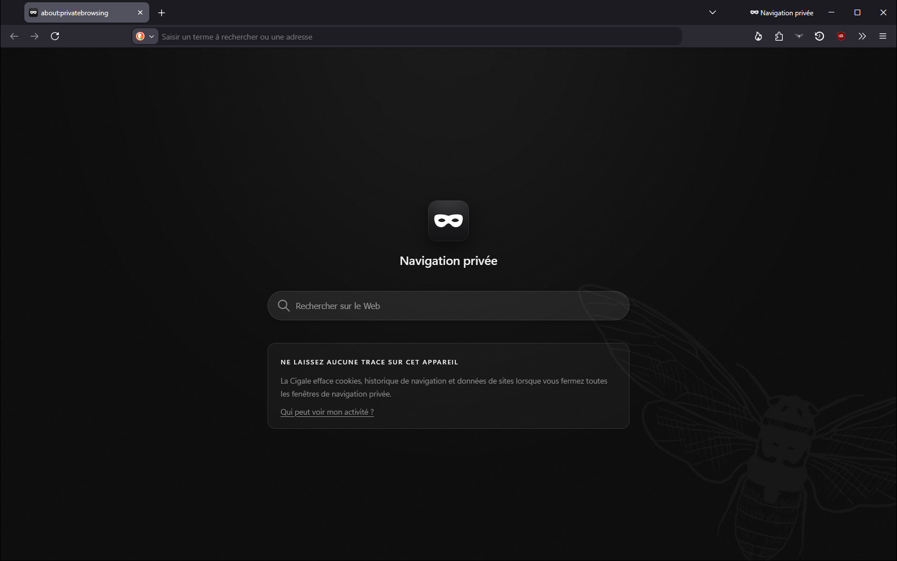
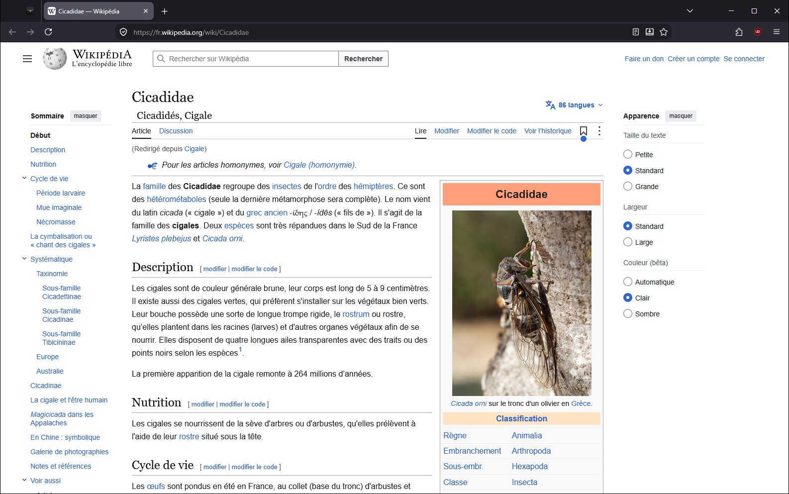
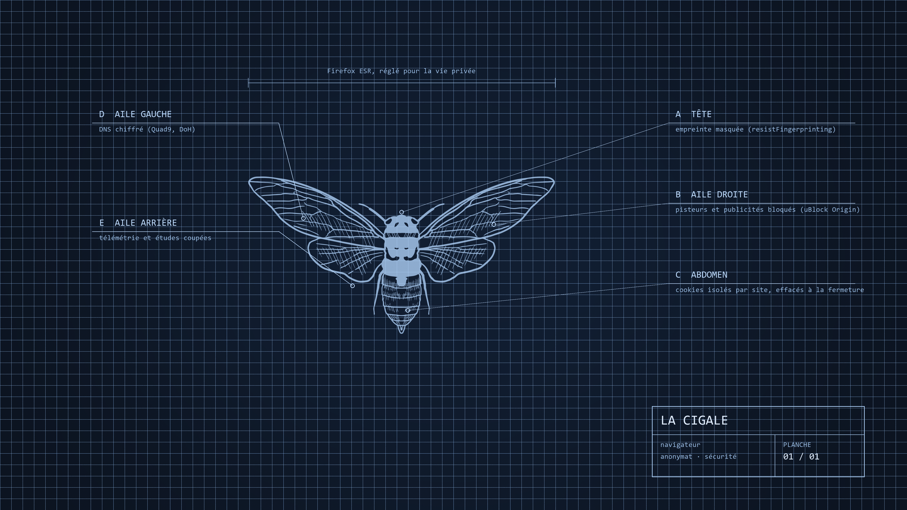

<p align="center"></p>

<h1 align="center">La Cigale</h1>
<p align="center"><b>Le navigateur libre qui ne chante pas vos données.</b><br>
Dérivé de Firefox ESR, durci pour l'anonymat, conçu en français.</p>

<p align="center"></p>

## Pourquoi La Cigale

- **Anonymat** : empreinte uniformisée façon Tor Browser, WebRTC coupé, DNS chiffré (Quad9) obligatoire.
- **Sécurité** : HTTPS imposé, TLS 1.2 minimum, OCSP obligatoire, uBlock Origin intégré.
- **Zéro télémétrie** : rien n'est envoyé à Mozilla ni à personne. Pas d'IA, pas de contenu sponsorisé.
- **Rien ne reste** : cookies, historique et cache effacés à la fermeture.
- **Léger** : composants inutiles retirés, aucun processus ni téléchargement en arrière-plan superflu.
- **100 % français** : interface, page d'accueil locale, moteurs DuckDuckGo (défaut), Qwant, Startpage, Lilo.
- **Trois profils en un clic** : Confort, Standard ou Renforcé (JavaScript coupé), depuis le bouton cigale.
- **Oublier ce site**, **fenêtre Tor**, **conteneurs**, **liens nettoyés**, **sauvegarde chiffrée**,
  **verrou au démarrage**, **mots-clés de recherche** : voir [Fonctions](#fonctions).

| | La Cigale | Firefox | Chrome | Edge |
|---|:---:|:---:|:---:|:---:|
| Télémétrie désactivée d'office | ✅ | ❌ | ❌ | ❌ |
| Bloqueur de publicités intégré | ✅ | ❌ | ❌ | ❌ |
| Anti-empreinte renforcé (type Tor Browser) | ✅ | ❌ | ❌ | ❌ |
| Données effacées à la fermeture | ✅ | ❌ | ❌ | ❌ |
| Code source ouvert | ✅ | ✅ | ❌ | ❌ |

<p align="center">
  
  
</p>

## Protection

Le bouton cigale de la barre d'outils ouvre `about:cigale` : l'état réel des protections, le choix du
profil, les sites où rester connecté et la vérification des mises à jour.

<p align="center"></p>

## Fonctions

| | |
|---|---|
| **Oublier ce site** | Bouton de la barre d'outils. Efface tout ce que La Cigale garde sur le site ouvert (cookies, cache, historique, autorisations, connexion) et ferme ses onglets. |
| **Fenêtre Tor** | Menu » de la barre d'outils, ou page Protection. Ouvre une fenêtre dont tout le trafic, DNS compris, passe par le réseau Tor, avec un profil à part effacé à la fermeture et une barre violette pour la reconnaître. Tor doit déjà tourner : Tor Browser ouvert (port 9150) ou le service `tor` sous Linux (port 9050). La Cigale ne fournit pas Tor, et pour un anonymat fort Tor Browser reste préférable. |
| **Cette page** | Dans la page Protection : pour l'onglet choisi, connexion chiffrée ou non, traqueurs, réseaux sociaux, détecteurs d'empreinte, mineurs et cookies bloqués, et le nombre de requêtes arrêtées par uBlock Origin. |
| **Conteneurs** | L'extension Multi-Account Containers de Mozilla est installée : un site peut toujours s'ouvrir dans son conteneur (banque, réseaux sociaux…), séparé du reste. |
| **Liens nettoyés** | Les paramètres de pistage (`utm_*`, `fbclid`, `gclid`, `msclkid`…) sont retirés des adresses. Clic droit sur un lien : « Copier le lien nettoyé ». |
| **Sauvegarde chiffrée** | Marque-pages, raccourcis de la page d'accueil, sites où rester connecté et profil dans un fichier `.cigale` chiffré (AES-256-GCM, clé dérivée du mot de passe par PBKDF2). Aucun serveur : vous le rangez où vous voulez et le restaurez sur un autre ordinateur. |
| **Mode lecture** | Touche F9 ou icône de page dans la barre d'adresse : texte seul, aux couleurs de La Cigale. |
| **Verrou au démarrage** | Un mot de passe demandé à l'ouverture. C'est un verrou, pas un chiffrement : il protège des curieux, pas de quelqu'un qui a accès à vos fichiers. |
| **Mots-clés de recherche** | Dans la barre d'adresse : `q` Qwant, `s` Startpage, `l` Lilo, `w` Wikipédia, `dico` Wiktionnaire, `osm` OpenStreetMap, `sp` Service-Public, `loi` Légifrance, suivis d'une espace et de la recherche. Exemple : `w cigale`. |

Après chaque mise à jour, La Cigale ouvre une fois la liste des nouveautés (`about:cigale#nouveautes`).

**Mot de passe du verrou oublié ?** Fermez La Cigale, ouvrez le fichier `prefs.js` du profil
(Windows : `%LOCALAPPDATA%\La Cigale\Profil`, version portable : dossier `Profil`, Linux :
`~/.local/share/la-cigale`) et supprimez les deux lignes qui contiennent `cigale.verrou`.

## Performances

<p align="center"></p>

Le durcissement ne coûte rien en vitesse : La Cigale est en tête sur JavaScript et DOM dans ce test.
Chrome et Edge démarrent plus vite et consomment moins de mémoire. Allégée de 38 Mo par rapport à Firefox
(composants d'IA, WebGPU, DRM et rapports de plantage retirés), elle tient dans un zip de 123 Mo. Mesures réelles, reproductibles avec
`python banc-essai/mesurer.py` (résultats bruts : [resultats.json](banc-essai/resultats.json)).

## Installer

**Windows : [télécharger la dernière version](https://github.com/urbanyl/la-cigale/releases/latest)**, puis au choix :
- `LaCigale-…-installeur.exe` : installation sans droits administrateur, raccourcis, désinstallation propre ;
- `LaCigale-…-portable.zip` : extraire et lancer `La Cigale (portable).cmd`.

Windows peut afficher un avertissement SmartScreen (installeur non signé) : « Informations complémentaires » puis « Exécuter quand même ».

**Ubuntu, Debian** (et dérivées : Linux Mint, Pop!_OS, elementary…) : télécharger le paquet `.deb` puis

```sh
sudo apt install ./la-cigale_*_amd64.deb
```

La Cigale apparaît dans le menu des applications et peut être choisie comme navigateur par défaut.
Le paquet ajoute aussi le dépôt APT de La Cigale : les mises à jour arrivent ensuite avec celles du système
(`sudo apt update && sudo apt upgrade`). Pour passer directement par le dépôt :

```sh
curl -fsSL https://github.com/urbanyl/la-cigale/releases/download/apt/la-cigale.gpg | sudo tee /usr/share/keyrings/la-cigale.gpg >/dev/null
echo "deb [arch=amd64 signed-by=/usr/share/keyrings/la-cigale.gpg] https://github.com/urbanyl/la-cigale/releases/download/apt ./" | sudo tee /etc/apt/sources.list.d/la-cigale.list
sudo apt update && sudo apt install la-cigale
```

Sans droits root : l'archive `.tar.gz` contient un `installer.sh` qui installe dans votre dossier personnel.
Une nouvelle version est construite automatiquement à chaque mise à jour de Firefox ESR.

Ou construire soi-même depuis les binaires officiels de Mozilla :

```powershell
.\construire-windows.ps1     # Windows : télécharge Firefox ESR, vérifie SHA-512 + signature Mozilla
```
```sh
./construire-linux.sh        # Linux : vérifie SHA-512 + signature GPG de Mozilla
```

Puis lancer `dist\LaCigale\La Cigale (portable).cmd`. Détails : [docs/construire.md](docs/construire.md) ·
choix de sécurité : [docs/securite.md](docs/securite.md).

## Fonds d'écran

Cinq fonds d'écran 4K (3840 × 2160) dans [fonds-ecran](fonds-ecran) : comme la page d'accueil, minimal,
motif, crépuscule provençal et plan technique. Ils se régénèrent avec `python outils/generer_fonds_ecran.py`.

<p align="center">
  
  
</p>

## Licence

MPL-2.0, comme Firefox. Firefox est une marque de la Mozilla Foundation ; La Cigale n'est ni affiliée
à Mozilla ni approuvée par elle. Logo : « Cicada » par Alex Muravev (The Noun Project, CC BY 3.0).
