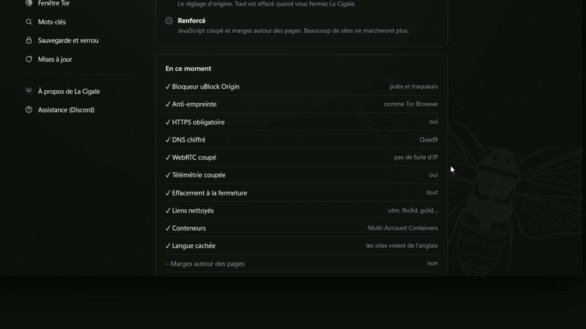
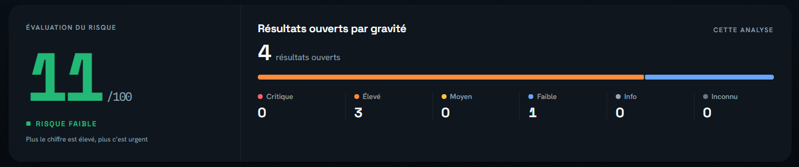
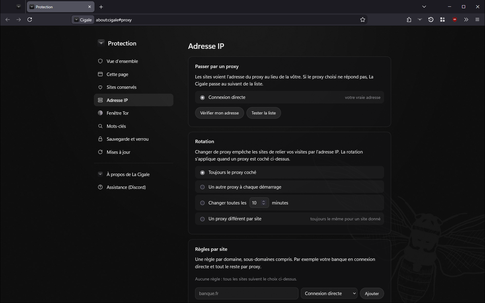
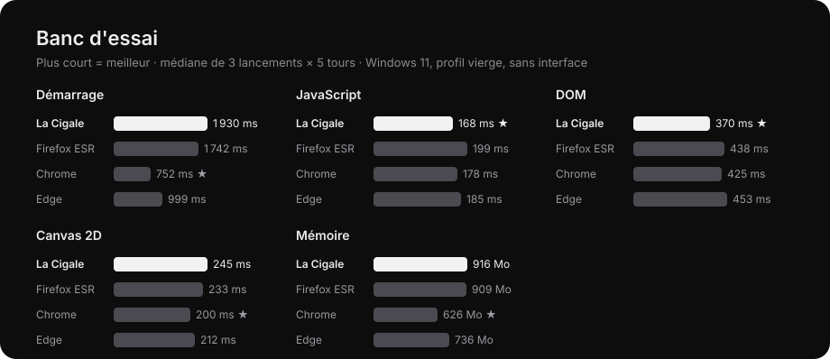

<p align="center"></p>

<h1 align="center">La Cigale</h1>
<p align="center"><b>Le navigateur libre qui ne chante pas vos données.</b><br>
Dérivé de Firefox ESR, durci pour l'anonymat, conçu en français.</p>

<p align="center">
<a href="https://github.com/urbanyl/la-cigale/releases/latest"></a>
<a href="https://github.com/urbanyl/la-cigale/releases"></a>
<a href="https://github.com/urbanyl/la-cigale/actions/workflows/construire.yml"></a>
<a href="LICENSE"></a>


<br>


<a href="https://www.kromse.com/scan?code=product_la_cigale"></a>


</p>

<p align="center"></p>

<p align="center"><a href="docs/captures/demo.mp4"></a><br>
<a href="docs/captures/demo.mp4">Voir la démonstration en vidéo (26 s, avec le son)</a></p>

<p align="center"><a href="https://www.kromse.com/scan?code=product_la_cigale"></a><br>
<sub>Analyse de sécurité indépendante par <a href="https://www.kromse.com/scan?code=product_la_cigale">Kromse</a> : risque faible, 11/100.</sub></p>

## Pourquoi La Cigale

- **Anonymat** : empreinte uniformisée façon Tor Browser, WebRTC coupé, DNS chiffré (Quad9) obligatoire.
- **Sécurité** : HTTPS imposé, TLS 1.2 minimum, OCSP obligatoire, uBlock Origin intégré.
- **Zéro télémétrie** : rien n'est envoyé à Mozilla ni à personne. Pas d'IA, pas de contenu sponsorisé.
- **Rien ne reste** : cookies, historique et cache effacés à la fermeture.
- **Léger** : composants inutiles retirés, aucun processus ni téléchargement en arrière-plan superflu.
- **100 % français** : interface, page d'accueil locale, moteurs DuckDuckGo (défaut), Qwant, Startpage, Lilo.
- **Trois profils en un clic** : Confort, Standard ou Renforcé (JavaScript coupé), depuis le bouton cigale.
- **Oublier ce site**, **fenêtre Tor**, **conteneurs**, **liens nettoyés**, **sauvegarde chiffrée**,
  **verrou au démarrage**, **mots-clés de recherche** : voir [Fonctions](#fonctions).

| Réglages d'origine | La Cigale | Firefox | Chrome | Edge |
|---|:---:|:---:|:---:|:---:|
| Télémétrie désactivée | oui | non | non | non |
| Bloqueur de publicités et de traqueurs (uBlock Origin) | oui | non | non | non |
| Bannières de cookies refusées toutes seules | oui | selon le pays | non | non |
| Anti-empreinte renforcé (type Tor Browser) | oui | non | non | non |
| HTTPS obligatoire | oui | non | non | non |
| DNS chiffré | oui (Quad9) | non | selon le fournisseur | selon le fournisseur |
| WebRTC coupé, pas de fuite de l'adresse IP | oui | non | non | non |
| Liens nettoyés (utm, fbclid, gclid…) | oui | non | non | non |
| Cookies, historique et cache effacés à la fermeture | oui | non | non | non |
| Fenêtre Tor intégrée | oui | non | non | non |
| Proxys avec rotation, règles par site et coupe-circuit | oui | non | non | non |
| Alerte si votre vraie adresse IP apparaît | oui | non | non | non |
| Verrou par mot de passe au démarrage | oui | non | non | non |
| Code source ouvert | oui | oui | non | non |

<p align="center">
  
  
</p>

## Protection

Le bouton cigale de la barre d'outils ouvre `about:cigale` : l'état réel des protections, le choix du
profil, les sites où rester connecté et la vérification des mises à jour.

<p align="center">
  
  
</p>

## Fonctions

| | |
|---|---|
| **Oublier ce site** | Bouton de la barre d'outils. Efface tout ce que La Cigale garde sur le site ouvert (cookies, cache, historique, autorisations, connexion) et ferme ses onglets. |
| **Fenêtre Tor** | Menu » de la barre d'outils, ou page Protection. Ouvre une fenêtre dont tout le trafic, DNS compris, passe par le réseau Tor, avec un profil à part effacé à la fermeture et une barre violette pour la reconnaître. Tor doit déjà tourner : Tor Browser ouvert (port 9150) ou le service `tor` sous Linux (port 9050). La Cigale ne fournit pas Tor, et pour un anonymat fort Tor Browser reste préférable. |
| **Cette page** | Dans la page Protection : pour l'onglet choisi, connexion chiffrée ou non, traqueurs, réseaux sociaux, détecteurs d'empreinte, mineurs et cookies bloqués, et le nombre de requêtes arrêtées par uBlock Origin. |
| **Conteneurs** | L'extension Multi-Account Containers de Mozilla est installée : un site peut toujours s'ouvrir dans son conteneur (banque, réseaux sociaux…), séparé du reste. |
| **Liens nettoyés** | Les paramètres de pistage (`utm_*`, `fbclid`, `gclid`, `msclkid`…) sont retirés des adresses. Clic droit sur un lien : « Copier le lien nettoyé ». |
| **Sauvegarde chiffrée** | Marque-pages, raccourcis de la page d'accueil, sites où rester connecté et profil dans un fichier `.cigale` chiffré (AES-256-GCM, clé dérivée du mot de passe par PBKDF2). Aucun serveur : vous le rangez où vous voulez et le restaurez sur un autre ordinateur. |
| **Mode lecture** | Touche F9 ou icône de page dans la barre d'adresse : texte seul, aux couleurs de La Cigale, avec lecture à voix haute (bouton casque). |
| **Bannières cookies** | Refus automatique quand le site le permet ; sinon les listes « cookies » et « nuisances » de uBlock Origin, activées d'office, masquent la bannière. |
| **Traduction** | Les pages dans une autre langue peuvent être traduites. La traduction tourne sur l'ordinateur, aucun texte n'est envoyé en ligne. |
| **Adresse IP** | Dans la page Protection : importez votre liste de proxys (format Webshare `ip:port:identifiant:mot de passe`) et choisissez celui à utiliser. Passage en SOCKS5, DNS résolu par le proxy. Rotation (à chaque démarrage, toutes les N minutes ou un proxy par site), règles par domaine (banque en direct, le reste par proxy), bascule sur le proxy suivant s'il ne répond pas, test de santé de la liste, coupe-circuit et alerte si la vraie adresse apparaît. |
| **Vérifier les fuites** | Dans la page Protection : adresse IP vue par les sites, DNS utilisé et adresses exposées par WebRTC. |
| **Mise à jour en un clic** | Sous Windows, « Mettre à jour » dans la barre d'avis télécharge le nouvel installeur, le lance et ferme La Cigale. |
| **Verrou au démarrage** | Un mot de passe demandé à l'ouverture. C'est un verrou, pas un chiffrement : il protège des curieux, pas de quelqu'un qui a accès à vos fichiers. |
| **Mots-clés de recherche** | Dans la barre d'adresse : `q` Qwant, `s` Startpage, `l` Lilo, `w` Wikipédia, `dico` Wiktionnaire, `osm` OpenStreetMap, `sp` Service-Public, `loi` Légifrance, suivis d'une espace et de la recherche. Exemple : `w cigale`. |

Après chaque mise à jour, La Cigale ouvre une fois la liste des nouveautés (`about:cigale#nouveautes`).

**Mot de passe du verrou oublié ?** Fermez La Cigale, ouvrez le fichier `prefs.js` du profil
(Windows : `%LOCALAPPDATA%\La Cigale\Profil`, version portable : dossier `Profil`, Linux :
`~/.local/share/la-cigale`) et supprimez les deux lignes qui contiennent `cigale.verrou`.

## Performances

<p align="center"></p>

Le durcissement ne coûte rien en vitesse : La Cigale est en tête sur JavaScript et DOM dans ce test.
Chrome et Edge démarrent plus vite et consomment moins de mémoire. Allégée de 38 Mo par rapport à Firefox
(composants d'IA, WebGPU, DRM et rapports de plantage retirés), elle tient dans un zip de 123 Mo. Mesures réelles, reproductibles avec
`python banc-essai/mesurer.py` (résultats bruts : [resultats.json](banc-essai/resultats.json)).

## Installer

**Windows : [télécharger la dernière version](https://github.com/urbanyl/la-cigale/releases/latest)**, puis au choix :
- `LaCigale-…-installeur.exe` : installation sans droits administrateur, raccourcis, désinstallation propre ;
- `LaCigale-…-portable.zip` : extraire et lancer `La Cigale (portable).cmd`.

Windows peut afficher un avertissement SmartScreen (installeur non signé) : « Informations complémentaires » puis « Exécuter quand même ».

**Ubuntu, Debian** (et dérivées : Linux Mint, Pop!_OS, elementary…) : télécharger le paquet `.deb` puis

```sh
sudo apt install ./la-cigale_*_amd64.deb
```

La Cigale apparaît dans le menu des applications et peut être choisie comme navigateur par défaut.
Le paquet ajoute aussi le dépôt APT de La Cigale : les mises à jour arrivent ensuite avec celles du système
(`sudo apt update && sudo apt upgrade`). Pour passer directement par le dépôt :

```sh
curl -fsSL https://github.com/urbanyl/la-cigale/releases/download/apt/la-cigale.gpg | sudo tee /usr/share/keyrings/la-cigale.gpg >/dev/null
echo "deb [arch=amd64 signed-by=/usr/share/keyrings/la-cigale.gpg] https://github.com/urbanyl/la-cigale/releases/download/apt ./" | sudo tee /etc/apt/sources.list.d/la-cigale.list
sudo apt update && sudo apt install la-cigale
```

Sans droits root : l'archive `.tar.gz` contient un `installer.sh` qui installe dans votre dossier personnel.
Une nouvelle version est construite automatiquement à chaque mise à jour de Firefox ESR.

Ou construire soi-même depuis les binaires officiels de Mozilla :

```powershell
.\construire-windows.ps1     # Windows : télécharge Firefox ESR, vérifie SHA-512 + signature Mozilla
```
```sh
./construire-linux.sh        # Linux : vérifie SHA-512 + signature GPG de Mozilla
```

Puis lancer `dist\LaCigale\La Cigale (portable).cmd`. Détails : [docs/construire.md](docs/construire.md) ·
choix de sécurité : [docs/securite.md](docs/securite.md).

## Fonds d'écran

Cinq fonds d'écran 4K (3840 × 2160) dans [fonds-ecran](fonds-ecran) : comme la page d'accueil, minimal,
motif, crépuscule provençal et plan technique. Ils se régénèrent avec `python outils/generer_fonds_ecran.py`.

<p align="center">
  
  
</p>

## Sécurité

Ce que La Cigale verrouille, comment ses versions sont vérifiées, ce qu'elle contacte sur le réseau
et ses limites : [page Sécurité](https://urbanyl.github.io/la-cigale/securite/) et
[docs/securite.md](docs/securite.md).

- **Versions vérifiables.** Firefox ESR est vérifié à la construction (SHA-512 et signature GPG de
  Mozilla, Authenticode sous Windows). Chaque version publie ses empreintes SHA-256 ; la mise à jour
  en un clic compare l'installeur téléchargé à l'empreinte publiée et s'arrête au moindre écart.
  Le dépôt APT est signé (ed25519, empreinte `8133 6ADC CAD0 2142 F542 BE53 E231 938C AAB4 F2D5`).
- **Ce qui sort sur le réseau.** Quad9 pour le DNS, OCSP pour les certificats, GitHub une fois par
  jour pour les mises à jour (désactivable), Mozilla si vous traduisez une page, api.ipify.org si vous
  lancez le test de fuites, et les sites de vos raccourcis pour leur logo. Rien d'autre.
- **Limites.** L'installeur Windows n'est pas signé ; la configuration tourne sans le bac à sable
  `autoconfig` parce qu'elle a besoin des droits du navigateur ; l'adresse IP n'est cachée que si vous
  choisissez un proxy (Protection, Adresse IP) ou la fenêtre Tor, et le fournisseur du proxy voit alors les sites visités.
- **Audit.** Un audit statique du code a été mené en novembre 2026
  ([rapport](docs/audit-securite-zh.md)). Une faille ? Signalez-la dans l'onglet
  [Security](https://github.com/urbanyl/la-cigale/security) du dépôt.

## Licence

MPL-2.0, comme Firefox. Firefox est une marque de la Mozilla Foundation ; La Cigale n'est ni affiliée
à Mozilla ni approuvée par elle. Logo : « Cicada » par Alex Muravev (The Noun Project, CC BY 3.0).
Icône Tor : « Tor Browser icon », The Tor Project ([Wikimedia Commons](https://commons.wikimedia.org/wiki/File:Tor_Browser_icon.svg), CC BY-SA 4.0) ; Tor est une marque de The Tor Project, Inc., qui n'est pas associé à La Cigale.
